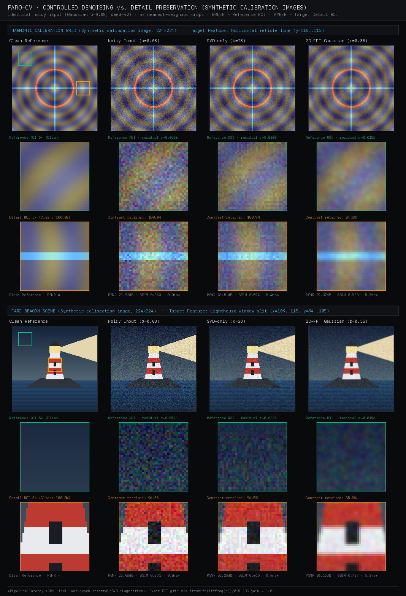
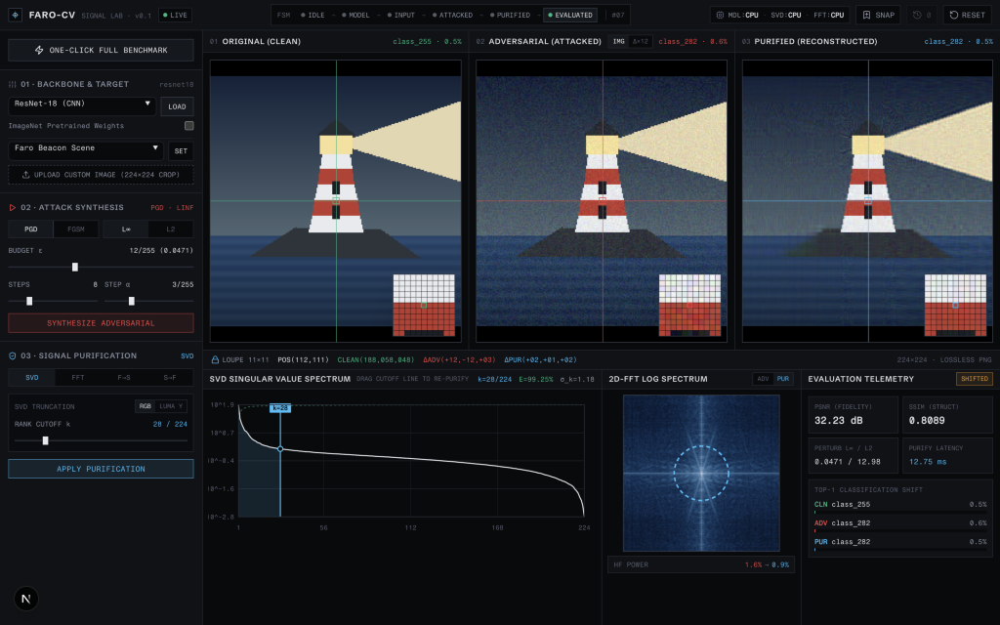
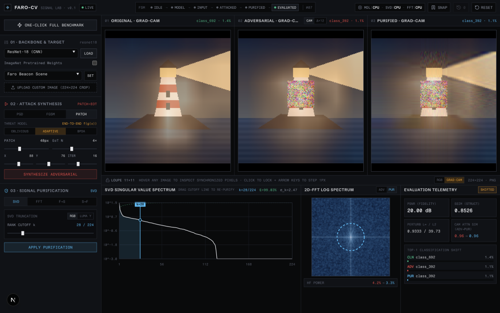

# faro-cv

**Interactive Computer Vision Signal Purification & Adversarial Robustness Laboratory**

**Live Study (Zero Backend):** [https://faro-cv.vercel.app](https://faro-cv.vercel.app) — compare Clean, Noisy, SVD, and 2D-FFT side-by-side and switch targets, seeds (`42 / 123 / 999`), and synchronized ROIs directly in the browser.

> **Key Finding (`Harmonic Grid`, `seed=42`, identical Gaussian noise `σ=0.08`):** 2D-FFT Gaussian (`r=0.35`) achieves higher overall PSNR (**29.37 vs. 26.51 dB**), while Truncated SVD (`k=28`) keeps thin-line local contrast closer to the clean reference (**100.9% vs. 84.6%**). Open the [live study](https://faro-cv.vercel.app) and toggle the **Amber Detail ROI** vs. **Green Reference ROI** to verify this trade-off directly.

`faro-cv` (*Faro*: Spanish for lighthouse/beacon) investigates how **Linear Algebra (Differentiable Truncated SVD)** and **2D Signal Processing (2D-FFT Radial Filtering)** attenuate image noise and adversarial perturbations—and **what exact fine details each method sacrifices in return**—inside a transactional **Finite State Machine (FSM)** and a zero-scroll desktop scientific workbench.

---

## Controlled Study: What Details Do SVD and 2D-FFT Lose While Denoising?

To make the denoising vs. detail-preservation trade-off directly inspectable, both `SVD-only (k=28)` and `2D-FFT Gaussian (r=0.35)` receive the **exact same noisy input** (fixed-seed Gaussian noise `σ=0.08`, `seed=42`) on two **Synthetic calibration images** (`224×224`). For each image, we magnify a pre-selected **Reference ROI** (green box, measuring luminance residual standard deviation `output − clean`) and a **Target Detail ROI** (amber box, measuring thin-line or sharp-edge luminance contrast `ΔL` and its ratio relative to the clean reference) at `5×` nearest-neighbor scale. The 2D-FFT kernel uses an exact centered DFT grid (`fftshift(fftfreq(n)) / 0.5`) with unit DC gain (`H(0,0) = 1.0`) and symmetric `(+f, -f)` weights.


*Synthetic calibration images (`harmonic_grid`, `beacon_target`, 224×224) under identical Gaussian noise (`σ=0.08`, `seed=42`). Reproducible via `make detail-study`.*

| Synthetic Calibration Image | Target Thin Feature | Method | PSNR (dB) | SSIM | Ref ROI Residual σ | Feature ΔL (Y) | Contrast Retained | Approx. Pipeline Latency (CPU, incl. diagnostics) |
|---|---|---|---:|---:|---:|---:|---:|---:|
| `harmonic_grid` | Horizontal reticle line (`y=110..113`) | Noisy (Unprocessed) | 21.92 | 0.3630 | 0.0528 | 0.2540 | 100.0% | — |
| `harmonic_grid` | Horizontal reticle line (`y=110..113`) | SVD-only (`k=28`) | 26.51 | 0.5940 | 0.0303 | 0.2560 | **100.9%** | ~8.4 ms |
| `harmonic_grid` | Horizontal reticle line (`y=110..113`) | 2D-FFT Gaussian (`r=0.35`) | **29.37** | **0.8329** | **0.0156** | 0.2148 | 84.6% | **~5.3 ms** |
| `beacon_target` | Lighthouse slit (`x=109..115, y=94..105`) | Noisy (Unprocessed) | 22.08 | 0.2512 | 0.0521 | 0.6309 | 96.5% | — |
| `beacon_target` | Lighthouse slit (`x=109..115, y=94..105`) | SVD-only (`k=28`) | 26.25 | 0.4647 | 0.0325 | 0.6309 | **96.5%** | ~8.4 ms |
| `beacon_target` | Lighthouse slit (`x=109..115, y=94..105`) | 2D-FFT Gaussian (`r=0.35`) | **28.16** | **0.7266** | **0.0156** | 0.5610 | 85.8% | **~5.3 ms** |

*Exact per-run CPU timings (mean of 20 runs after 5 warmup passes) are recorded in the auto-generated [detail_tradeoff_summary.md](experiments/results/detail_tradeoff_summary.md) and [detail_tradeoff.csv](experiments/results/detail_tradeoff.csv).*

### Factual Observations
- **Whole-image fidelity, Reference ROI residual & pipeline latency favor 2D-FFT Gaussian (`r=0.35`)**: Across both synthetic calibration images, 2D-FFT Gaussian achieves higher PSNR (`+1.91` to `+2.86 dB`), higher SSIM (`+0.24` to `+0.26`), roughly half the Reference ROI luminance residual (`σ=0.0156` vs. `0.0303–0.0325`), and lower full-pipeline CPU latency (`~5.3 ms` vs. `~8.4 ms`, including workbench spectral/SVD diagnostics).
- **Local contrast on these two pre-selected thin features favors SVD-only (`k=28`)**: Under these two specified features and fixed filter parameters (`k=28`, `r=0.35`), SVD keeps local luminance contrast closer to the clean reference (`96.5%–100.9%` at `seed=42`; confirmed across `seed=123` and `seed=999` in [detail_tradeoff_summary.md](experiments/results/detail_tradeoff_summary.md)), whereas isotropic 2D-FFT low-pass filtering reduces feature contrast to `83.8%–87.9%` across all three seeds.
- **No single operator dominates**: Choosing between SVD and 2D-FFT trades overall residual smoothness and pipeline runtime against local edge contrast on axis-aligned thin features.

**Reproduce & Inspect**: [Experiment Script](experiments/detail_tradeoff_study.py) · [Raw CSV (3 Seeds)](experiments/results/detail_tradeoff.csv) · [Markdown Summary (incl. Seeds 123 & 999)](experiments/results/detail_tradeoff_summary.md)

---

## Interactive Instrument Workbench

`faro-cv` pairs a **FastAPI + WebSocket** backend with a zero-scroll **Next.js 15 / React 19** desktop instrument (`Schibsted Grotesk` + `Fragment Mono`) featuring a synchronized 3-column **11×11 lossless pixel loupe** (click to lock + arrow keys to step `1px`), a **60fps draggable SVD singular value cutoff line**, a **2D-FFT log-magnitude spectrum analyzer**, and synchronized **Grad-CAM** overlays.

### Synchronized 3-Column 11×11 Pixel Loupe & Interactive SVD Cutoff Line


### Adversarial Patch + EoT, White-Box Adaptive Penetration & Synchronized Grad-CAM Overlay


---

## Core Engineering & Adversarial Capabilities

- **Formal Transactional FSM (`src/faro_cv/core/fsm.py`)**: Models every session as a guarded 5-tuple $M = (Q, \Sigma, \delta, q_0, F)$ with atomic rollback on guard failure, deterministic error recovery anchors, immutable audit history, WebSocket observer hooks, time-travel snapshots, and canonical Mermaid export (`make fsm-diagram`).
- **Perturbation, Physical Patch & White-Box Adaptive Attacks (`src/faro_cv/attacks/`)**:
  - `FGSM` & `PGD` ($L_\infty / L_2$, targeted/untargeted, live step-by-step WebSocket streaming).
  - `Adversarial Patch + EoT` (localized patches optimized under stochastic rotation, scale, translation, and photometric jitter).
  - **White-Box Adaptive Evaluation (`Exact` & `BPDA`)**: Differentiates end-to-end through `f(g(x))`—including $10^{-5}$ jitter stabilization against zero singular-value Jacobian degeneracies—or applies Straight-Through BPDA to expose obfuscated gradients.
- **Differentiable Matrix & Spectral Purification (`src/faro_cv/defenses/`)**: Truncated SVD (rank $k$ or cumulative energy $\tau$; RGB or BT.601 Luminance $Y$), 2D-FFT radial/band-stop filtering (Gaussian, Butterworth, Ideal, Band-stop; phase preservation), and composite `FFT → SVD` / `SVD → FFT` chains.
- **Cross-Architecture Grad-CAM & Split Evaluation Metrics (`src/faro_cv/analysis/`)**: Supports `ResNet-18`, `MobileNetV3-Small`, and `ViT-B/16` spatial Grad-CAM overlays, strictly separating **Flip Rate (ASR)**, **Prediction Consistency Rate** (all samples), **Conditional Recovery Rate** (flipped samples only; `N/A` if 0 flipped), and optional **Ground-Truth Accuracy** (`--labels-csv`).

---

## Adversarial Calibration Findings (`n=3` Synthetic Targets, Offline `ResNet-18`, `seed=42`)

> **Scope note**: The deterministic adversarial ablation (`make benchmark`) runs on `n=3` unlabeled synthetic 224×224 calibration targets with offline deterministically seeded (`seed=42`) `ResNet-18` weights to verify pipeline reproducibility, signal-domain purification trade-offs, and white-box adaptive gradient flow. Classification accuracy on real photos should be evaluated with `--pretrained --image-dir <dir> --labels-csv <labels.csv>`. Full split tables are in [docs/TECHNICAL_REPORT.md](docs/TECHNICAL_REPORT.md) and [experiments/results/benchmark_results.csv](experiments/results/benchmark_results.csv).

1. **White-Box Adaptive Subspace Alignment**: Against oblivious PGD-10 (`L∞ = 12/255`, `n=3`), RGB SVD (`k=28`) achieves `33.10 dB` PSNR / `0.8281` SSIM and halves HF energy (`1.50% → 0.76%`). Under **Exact Adaptive** PGD-10 differentiating directly through `f(g(x))`, SVD fidelity drops to `29.75 dB` PSNR / `0.6724` SSIM with `76%` of HF perturbation surviving (`1.44% → 1.10%`).
2. **Chrominance Bypass**: Luminance-only SVD (`k=28`, BT.601 $Y$) is ~1.9× faster (`~4.8 ms` vs. `~9.2 ms`), but incurs a `-3.46 dB` PSNR / `-0.170` SSIM drop (`29.64 dB` / `0.6581`) on RGB PGD-10 because perturbations in $C_b / C_r$ bypass luminance projection.
3. **Global SVD vs. Localized Patches**: Against 48×48px EoT patches (`n=3`), `2D-FFT Gaussian` (`23.88 dB` PSNR / `0.9227` SSIM, HF `4.56% → 0.23%`, conditional recovery `1/3`) outperforms global `SVD` (`21.05 dB` / `0.8863`, HF `4.56% → 3.60%`, conditional recovery `0/3`), which exhibits row/column rank-truncation ghosting streaks.

---

## Repository Structure

```text
faro-cv/
├── src/faro_cv/
│   ├── core/          # Transactional FSM, ExperimentContext, Pydantic schemas, MPS probe, LabSession
│   ├── models/        # NormalizedVisionModel wrapper & ResNet-18 / MobileNetV3 / ViT-B/16 registry
│   ├── attacks/       # FGSM, PGD, Adversarial Patch + EoT, AdaptiveDefendedModel (Exact & BPDA)
│   ├── defenses/      # Differentiable Truncated SVD, 2D-FFT radial/band-stop, composite pipelines
│   ├── analysis/      # PSNR, SSIM, Lp norms, CNN/ViT Grad-CAM & split consistency/recovery metrics
│   └── api/           # FastAPI REST & WebSocket workbench server + lossless PNG/colormap encoders
├── web/               # Next.js 15 + React 19 + Tailwind zero-scroll scientific instrument UI
├── experiments/       # Detail trade-off study & adversarial ablation CLIs + CSV/Markdown outputs
├── tests/             # Strict pytest suite (FSM, attacks, defenses, adaptive, Grad-CAM, API, studies)
├── docs/              # Architecture specification, Technical Report & comparison figures
├── .github/workflows/ # CI pipeline (ruff, mypy --strict, pytest, Next.js typecheck & build)
├── Makefile           # Single-command setup, verification, studies, and dev server targets
└── pyproject.toml     # Build metadata, dependencies, ruff, mypy, pytest configuration
```

---

## Quickstart

Requires **Python 3.11+** (Apple Silicon ARM64 recommended on macOS) and **Node.js 20+**.

```bash
# 1. Create .venv and install full ML (PyTorch MPS), FastAPI, and dev tools
make setup-all

# 2. Install Next.js workbench dependencies
npm --prefix web install

# 3. Run full backend quality gate (ruff, mypy --strict, pytest + coverage)
make check

# 4. Reproduce the controlled SVD vs. 2D-FFT detail trade-off figure & CSV
make detail-study

# 5. Launch backend (127.0.0.1:8000) and frontend (localhost:3000) in separate terminals
make dev-api
make dev-web
```

---

## Documentation

- **SVD vs. 2D-FFT Detail Trade-Off Summary**: [experiments/results/detail_tradeoff_summary.md](experiments/results/detail_tradeoff_summary.md)
- **Technical Report & Adversarial Ablations**: [docs/TECHNICAL_REPORT.md](docs/TECHNICAL_REPORT.md)
- **System Architecture & FSM Specification**: [docs/architecture.md](docs/architecture.md)
- **Raw Benchmark CSVs**: [detail_tradeoff.csv](experiments/results/detail_tradeoff.csv) · [benchmark_results.csv](experiments/results/benchmark_results.csv)

---

## License

Released under the [MIT License](LICENSE).
