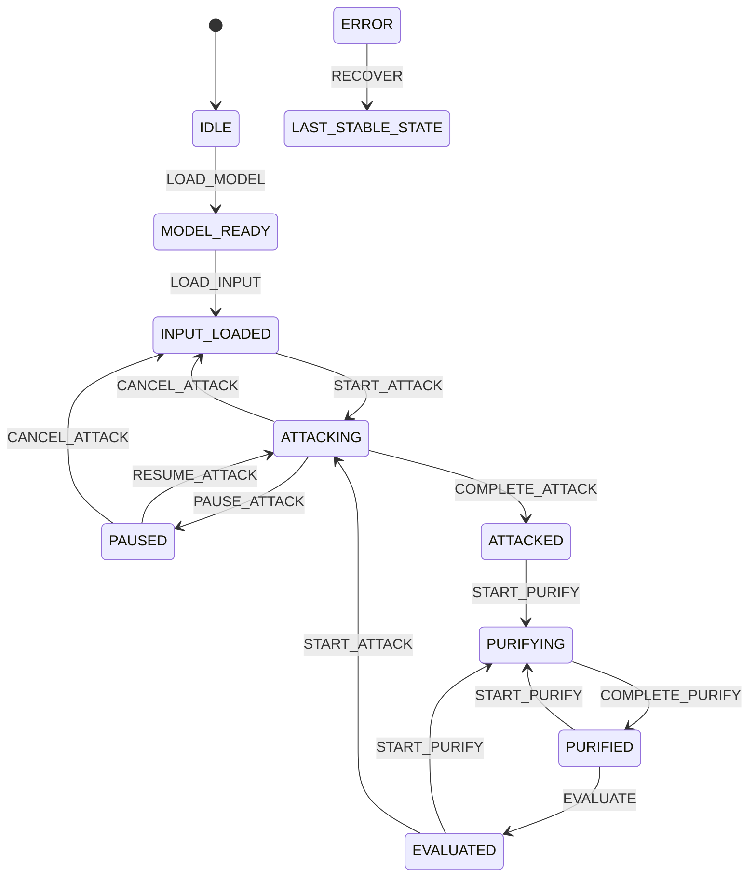

# faro-cv Architecture Specification

> **faro-cv** (*Faro*: Spanish for lighthouse/beacon) is an interactive adversarial computer vision laboratory combining **Linear Algebra (SVD)**, **2D Signal Processing (2D-FFT)**, and a **Transactional Finite State Machine (FSM)** inside a precision scientific-instrument workbench.

---

## 1. Layered Architecture

`faro-cv` enforces strict separation between the mathematical engine, state machine governance, transport layer, and interactive visualization workbench:

```text
+-------------------------------------------------------------------+
|  Next.js Zero-Scroll Workbench (Phase 3)                          |
|  - Synchronized 3-Column Pixel Loupe (Canvas ImageData)           |
|  - Interactive SVD Cutoff Line Scree Plot                         |
|  - 2D-FFT Centered Log-Magnitude Spectrum & Radial Mask           |
+---------------------------------+---------------------------------+
                                  | REST + WebSocket (FSMWireState)
+---------------------------------v---------------------------------+
|  FastAPI Transport Layer (src/faro_cv/api/)                       |
+---------------------------------+---------------------------------+
                                  |
+---------------------------------v---------------------------------+
|  FSM Governance Layer (src/faro_cv/core/fsm.py)                   |
|  - Transactional transitions: stage -> mutate -> guard -> commit  |
|  - Immutable audit history, observer hooks, time-travel snapshots |
+-------------------+---------------------------+-------------------+
                    |                           |
+-------------------v-----------+   +-----------v-------------------+
|  Attack Engine (attacks/)     |   |  Purification Engine          |
|  - FGSM, PGD (L_inf / L_2)    |   |  - Truncated SVD / Energy     |
|  - Adversarial Patch + EoT    |   |  - 2D-FFT Gaussian/Butterworth|
|  - White-box Adaptive / BPDA  |   |  - Composite Pipelines        |
+-------------------+-----------+   +-----------+-------------------+
                    |                           |
+-------------------v---------------------------v-------------------+
|  Apple Silicon MPS-Aware Device Router (core/device.py)           |
|  - Startup micro-probe for Model / SVD / 2D-FFT operators         |
|  - Seamless CPU fallback preserving Autograd where required       |
+-------------------------------------------------------------------+
```

---

## 2. Formal Finite State Machine Definition

The laboratory session lifecycle is governed by a deterministic, guarded Finite State Machine:

$$M = (Q, \Sigma, \delta, q_0, F)$$

- **State Set ($Q$)**:
  `{IDLE, MODEL_READY, INPUT_LOADED, ATTACKING, PAUSED, ATTACKED, PURIFYING, PURIFIED, EVALUATED, ERROR}`
- **Event Alphabet ($\Sigma$)**:
  `{LOAD_MODEL, LOAD_INPUT, START_ATTACK, PAUSE_ATTACK, RESUME_ATTACK, CANCEL_ATTACK, COMPLETE_ATTACK, START_PURIFY, COMPLETE_PURIFY, EVALUATE, FAIL, RECOVER, RESET}`
- **Initial State ($q_0$)**: `IDLE`
- **Accepting State Set ($F$)**: `{EVALUATED}` (interactive re-purification loops from `PURIFIED` and `EVALUATED` remain first-class to support live SVD cutoff scrubbing)
- **Transition Function ($\delta$)**: Declaratively specified in `src/faro_cv/core/fsm.py:TRANSITION_TABLE`.

### Transactional Semantics
Every `dispatch(event, mutate=...)` call follows an all-or-nothing transaction:
1. Verify `(current_state, event)` exists in `TRANSITION_TABLE`; otherwise raise `InvalidTransitionError`.
2. Clone `ExperimentContext` into a staged copy and apply deterministic downstream invalidation rules (e.g., loading a new input clears stale adversarial/purified artifacts).
3. Apply the caller's optional `mutate(staged_ctx)`.
4. Evaluate all `TransitionGuard` predicates on `staged_ctx`; if any guard fails, raise `GuardRejectedError` with zero mutation to live state.
5. Atomically commit `(state, context)`, update the stable recovery anchor, append a `TransitionRecord`, and notify subscribed observers (e.g., WebSocket broadcasters).

### Canonical State Diagram



---

## 3. Apple Silicon (MPS) Operator Routing Strategy

On Apple Silicon Macs, PyTorch MPS dramatically accelerates vision backbones (`ResNet-18`, `MobileNetV3`, `ViT`) and iterative PGD/Patch optimization. However, complex-valued 2D-FFT (`torch.fft.fft2`) and SVD (`torch.linalg.svd`) support on MPS varies across PyTorch releases.

`core/device.py` solves this deterministically:
1. Run tiny 16x16 startup micro-probes for `model_op`, `svd_op`, and `fft_op`.
2. Record exact per-operator device placement, probe latency (ms), and fallback rationale inside `OperatorDeviceProfile`.
3. Surface this telemetry directly in the workbench top instrument bar (e.g., `Model: MPS (4.1ms) | SVD: CPU (5.8ms)`).
